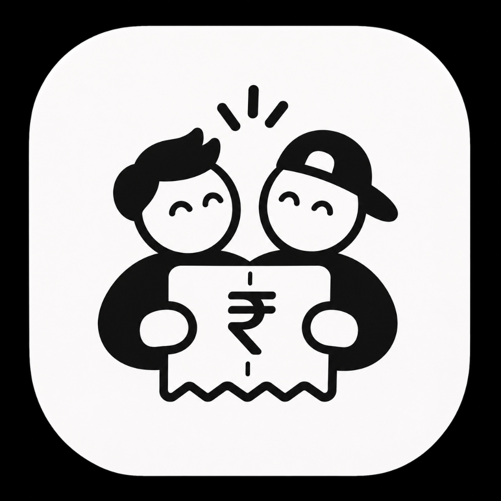

# ⚡ BillSplit — Neumorphic Bill Splitter

<p align="center">
  
</p>

<p align="center">
  <b>A sleek, tactile Neumorphic Bill Splitter application built with Flutter & Apple Design Guidelines.</b>
</p>

<p align="center">
  <a href="https://github.com/roshan-codes/flutter-bill-splitter/releases/latest/download/app-release.apk">
    
  </a>
  <a href="https://github.com/roshan-codes/flutter-bill-splitter/releases">
    
  </a>
  
</p>

---

## 📲 Download Release APK

Get the latest production-ready Android APK directly:

<p align="center">
  <a href="https://github.com/roshan-codes/flutter-bill-splitter/releases/latest/download/app-release.apk">
    
  </a>
</p>

| Specification | Detail |
| :--- | :--- |
| **Package** | `app-release.apk` |
| **Version** | `1.0.0+1` (`v1.0.0`) |
| **File Size** | `21.8 MB` |
| **Architecture** | Universal (ARM64, ARMv7, x86_64) |
| **Direct Download** | [📥 **Download `app-release.apk`**](https://github.com/roshan-codes/flutter-bill-splitter/releases/latest/download/app-release.apk) |
| **Release Page** | [View GitHub Releases](https://github.com/roshan-codes/flutter-bill-splitter/releases) |

> **Installation Note**:
> 1. Download the APK onto your Android phone.
> 2. Open the downloaded file from your notifications or file manager.
> 3. If prompted, allow *"Install from unknown sources"* for your browser/file manager.

---

## ✨ Features

- 🎨 **3D Neumorphic Aesthetic**: Soft shadows, inset input surfaces, elevated cards, and neon lime accents (`#86E829`).
- 🍎 **Apple Design Guidelines Compliance**:
  - Minimum 44×44pt touch targets on all interactive controls.
  - Tactile Haptic Feedback (`selectionClick`, `lightImpact`, `mediumImpact`).
  - Screen reader accessibility labels & `Semantics` on custom components.
  - Destructive confirmation dialogs for removing friends or groups.
- 📇 **Import from Contacts**:
  - Native integration with Android & iOS address books via `flutter_contacts`.
  - Batch / multi-select contacts to quickly invite friends.
  - Inset live search to find friends instantly.
- 💸 **Fair Bill Splitting Engine**:
  - Equal and itemized expense breakdowns.
  - Automated "Who Pays Whom" debt simplification algorithm.
  - Net balance tracking ("You Get" and "You Owe").
- 💾 **100% Offline Persistence**:
  - Automatic serialization and saving with `shared_preferences`.
  - Data remains intact across app restarts and device reboots.
- 🚀 **Interactive Onboarding & Splash**:
  - Swipeable `PageView` walkthrough with animated page indicator dots.

---

## 🛠 Tech Stack & Dependencies

- **Framework**: [Flutter](https://flutter.dev) (SDK `^3.5.4`)
- **Neumorphism**: `flutter_neumorphism_ui: ^1.0.2`
- **Navigation Bar**: `neumorphic_glass_navbar: ^0.0.1`
- **Contacts**: `flutter_contacts: ^1.1.9+2`
- **Persistence**: `shared_preferences: ^2.5.3`
- **Typography**: `google_fonts: ^6.2.1`
- **Icons**: `cupertino_icons: ^1.0.8`

---

## 🚀 Getting Started

### Prerequisites
- Flutter SDK (3.24+)
- Android Studio / Xcode

### Running Locally

```bash
# Clone the repository
git clone https://github.com/roshan-codes/flutter-bill-splitter.git
cd flutter-bill-splitter

# Install dependencies
flutter pub get

# Run analyzer
flutter analyze

# Run all tests (41 passing)
flutter test

# Run the app
flutter run
```

### Building Release Packages

```bash
# Build Android Release APK
flutter build apk --release

# Output path:
# build/app/outputs/flutter-apk/app-release.apk
```

---

## 📄 License

This project is licensed under the MIT License.
