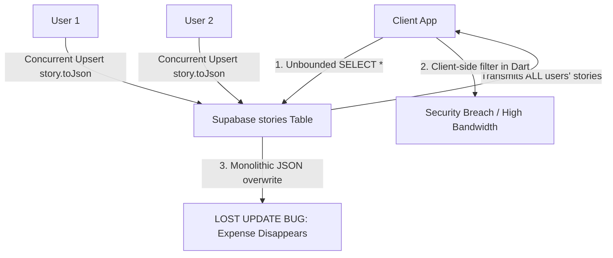

# 00 — Executive Summary: TTMM Club Technical Audit

**Application:** TTMM Club (Flutter Bill Splitter / Group Expense Sharing)  
**Evaluator Roles:** Principal Software Architect, Senior Flutter Engineer, Senior Python Backend Engineer, Database Architect, Security Engineer, Code Quality Auditor  
**Date of Audit:** November 18, 2026  
**Scope:** Complete Codebase (`lib/` 27,055 LoC across 97 files, `test/` 7,310 LoC across 33 test suites, configuration, backend integrations, and deployment infrastructure).

---

## 1. Overall Health Scorecard

| Domain | Rating | Score (0–100) | Status | Key Observation |
| :--- | :---: | :---: | :---: | :--- |
| **Visual Design & UX Craft** | **Exceptional** | **94** | 🟢 Production Ready | Tactile Neumorphism, Apple HIG compliance, micro-animations, and custom visual identity. |
| **Financial Invariants (Domain)** | **Strong** | **85** | 🟢 Sound Core | Strict algebraic zero-sum verification ($\sum \text{Net} = 0$), debt simplification algorithms. |
| **Automated Testing Suite** | **Very Good** | **82** | 🟢 Reliable | 33 comprehensive test suites covering financial invariants, settlement logic, UI edge cases. |
| **Frontend Architecture** | **Poor** | **38** | 🔴 Critical Risk | Severe "God Widget" anti-pattern (`split_detail_screen.dart` at 5,756 lines); mixed UI/state/IO. |
| **Database & Schema Design** | **Poor** | **34** | 🔴 Critical Risk | Monolithic JSON document storage in relational table (`data` JSONB); lost update concurrency hazard. |
| **Backend & Cloud Security** | **Critical** | **28** | 🔴 Urgent Blocker | Full table scan without server-side `WHERE` or enforced RLS; exposure of all tenant stories. |
| **Concurrency & Scalability** | **Poor** | **32** | 🔴 Scalability Risk | Unsafe client-side upsert race conditions; $O(N)$ full story JSON downloads on app launch. |
| **Code Modularity & Cleanliness** | **Moderate** | **52** | 🟡 Needs Work | Duplicated arithmetic engines, hardcoded fallback strings, scattered persistence calls. |

**Composite Engineering Health Index:** **55.6 / 100** — *High-Craft Prototype with Critical Architectural & Security Liabilities.*

---

## 2. Executive Synthesis

TTMM Club demonstrates **world-class user interface craft, tactile interaction feedback, and robust mathematical testing**. The visual presentation adheres to Apple Human Interface Guidelines with custom squircle geometry, fluid transitions, and a consistent Neumorphic color palette. The core financial invariants ($\sum \text{Net} = 0$, equal/exact split math, settlement minimization) are verified by extensive automated tests.

However, beneath this polished surface lie **four foundational architectural weaknesses** that prevent the application from being safe, scalable, or maintainable in production:

1. **Extreme Monolithic Screen Files ("God Widgets"):**  
   The primary screen, `split_detail_screen.dart`, has swollen to **5,756 lines of code**. It combines state management, network polling, Supabase Realtime subscriptions, form validation, 7 modal bottom sheets, tag ranking, image rendering, and financial recalculations in a single class.
2. **Monolithic JSON Document Store with Concurrency Lost-Update Risk:**  
   The backend schema treats PostgreSQL as a naive JSON key-value store. The entire story (members, expenses, split allocations, settlements) is written as a single `data: story.toJson()` blob. If two members record an expense simultaneously, the last writer silently overwrites and deletes the other's entry.
3. **Severe Security & Data Isolation Vulnerability:**  
   `SupabaseService.fetchStories()` executes `.from('stories').select().order('created_at')` with **no server-side tenant filter**. Every story, participant name, expense amount, and settlement in the database is transmitted over the wire to every connected client, relying on client-side Dart loops for filtering. Without enforced Postgres Row-Level Security (RLS), any authenticated user can inspect the entire database.
4. **Duplicated Floating-Point Arithmetic Engines:**  
   Financial calculations are duplicated between `ExpenseCalculator` and `Story._buildCalculatedStory`. Both engines use standard 64-bit IEEE 754 floating-point `double` rather than integer minor units (paise/cents) or fixed-point decimal arithmetic, risking cumulative sub-cent rounding drift.

---

## 3. Main Strengths

- **Bespoke Apple HIG & Neumorphic Design System:** Fluid physics (`animations` package), haptic feedback, memo avatar kit (35 male/female illustrated personas), and dark/light contrast discipline.
- **Exhaustive Domain Invariant Test Suite:** 33 test suites (7,310 LoC) verifying complex multi-party splits, debt simplification, zero-sum balances, and advance payments.
- **Graceful Offline-First Fallbacks:** Seamless degraded mode when Supabase is unreachable, persisting locally via `SharedPreferences` and in-memory caches.
- **Deep-Link Dynamic Story Invitation:** Comprehensive universal linking flow allowing immediate group onboarding via URL tokens and QR codes.

---

## 4. Top Critical Risks (Urgent Blockers)

1. **Information Disclosure (CVSS 8.5):** Unbounded `select()` on `stories` and `activities` tables exposes private financial transactions across all registered users.
2. **Silent Financial Data Loss:** Monolithic JSON document upserts cannot resolve concurrent writes without ACID table normalization or optimistic concurrency locking.
3. **Client OOM / Network Degradation:** Once platform user count reaches 10,000 stories, client devices will download megabytes of JSON on every launch, causing UI freezes and excessive cellular data consumption.
4. **Fragile State Synchronization:** UI components frequently bypass repositories and directly manipulate in-memory lists, causing state desynchronization between tabs.

---

## 5. High-Level Recommendation Roadmap

| Phase | Focus Area | Actions | Effort |
| :---: | :--- | :--- | :---: |
| **P0** | **Security & Isolation** | Enable Postgres RLS; add `user_id` / membership security policies; restrict REST queries to user's stories. | Small |
| **P1** | **Database Normalization** | Migrate from monolithic `data` JSON blob to normalized relational tables (`stories`, `members`, `expenses`, `shares`, `settlements`). | Medium |
| **P2** | **Deconstruct God Widget** | Refactor `split_detail_screen.dart` into modular tabs, dedicated controllers, and atomic feature widgets. | Large |
| **P3** | **Financial Engine Unification** | Consolidate `ExpenseCalculator` into a single authoritative integer-paise engine. | Medium |
| **P4** | **State Management Modernization**| Replace ad-hoc `setState` / singleton `ChangeNotifier` with scoped Riverpod or Bloc state containers. | Medium |
