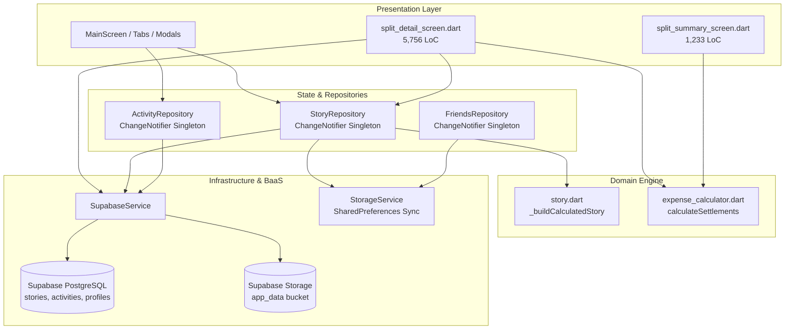

# 01 — Project Structure & Module Organization

## 1. Directory Tree & Architecture Topology

```
flutter-bill-splitter/
├── android/                         # Native Android configuration, Gradle wrapper, launcher icons
├── ios/                             # Native iOS project, Podfile, AppFrameworkInfo
├── macos/                           # macOS desktop runner configuration
├── web/                             # Web harness, index.html, Web Workers, PWA manifest
├── assets/                          # Static assets: App icons, illustrations, 35 memo avatars
├── packages/                        # In-tree vendor packages (google_fonts fork with Dart 3.7+ patch)
├── lib/                             # Core Flutter application source code (27,055 LoC)
│   ├── main.dart                    # Application entry point, service bootstrapping, deep-link routing
│   ├── app/                         # App-level orchestration
│   │   └── app.dart                 # MaterialApp configuration, global themes, transitions
│   ├── core/                        # Shared framework foundations
│   │   ├── animations/              # Standard easing curves and route transition builders
│   │   ├── config/                  # Supabase endpoints, public keys, deep-link hosts
│   │   ├── constants/               # Expense categories, system constants
│   │   ├── errors/                  # Custom application exceptions and error types
│   │   ├── routing/                 # Auth gate and deep-link redirection
│   │   ├── services/                # Supabase BaaS, local storage, invite token generator
│   │   ├── theme/                   # Neumorphic color palette, typography, radii, spacing
│   │   └── utils/                   # Avatar resolvers, currency/date formatters, string helpers
│   ├── features/                    # Feature-driven vertical slices
│   │   ├── activity/                # Split activity log (models, repository, screens, widgets)
│   │   ├── expenses/                # Core expense calculation, detail screens, summary sheets
│   │   ├── friends/                 # Friend management, contact import, groups
│   │   ├── home/                    # Dashboard tab (active stories, recent activity, balance cards)
│   │   ├── navigation/              # Main scaffold with floating glassmorphic navbar
│   │   ├── onboarding/              # Splash screen, welcome carousel, auth entrance
│   │   ├── profile/                 # User profile, memo avatar picker, Google account sync
│   │   └── stories/                 # Story models, creation wizard, join flow, repository
│   └── shared/                      # Universally shared atomic UI widgets
│       └── widgets/                 # AppAvatar, SquircleAvatar, EmptyStateView, GoogleSignInButton
├── test/                            # Comprehensive automated testing suite (33 test files, 7,310 LoC)
├── pubspec.yaml                     # Dependencies and asset declarations
├── render-build.sh                  # Render.com CI/CD shell deployment pipeline
└── analysis_options.yaml            # Dart static analysis configuration and linter rules
```

---

## 2. Directory Responsibilities & Engineering Assessment

### `lib/core/`
- **Responsibility:** Houses cross-cutting concerns that have no feature-specific business logic: theme definitions, utilities, low-level service clients (Supabase, SharedPreferences), animations, and formatting.
- **Functionality Contained:**
  - `SupabaseService`: BaaS client initialization, auth listener, table queries, storage upload.
  - `StorageService`: In-memory synchronous cache wrapping `SharedPreferences`.
  - `AppTheme`, `AppColors`, `AppRadius`: Neumorphic styling tokens.
  - `AvatarResolver`, `CurrencyFormatter`, `DateFormatter`: Standardized string/asset converters.
- **Appropriateness:** **Appropriate with caveats.**
- **Overlap & Weaknesses:** `SupabaseService` contains domain-specific story and activity queries (`saveStory`, `fetchStories`, `saveActivity`, `fetchActivities`), which violates layer abstraction. Data access queries belong inside feature repositories (`StoryRepository`, `ActivityRepository`), not in `core/services`.
- **Reorganization Recommendation:** Keep `SupabaseService` strictly as a thin infrastructure client (managing auth state, client connection, storage uploads). Move table queries into feature data sources.

---

### `lib/features/stories/`
- **Responsibility:** Manages the lifecycle of a bill-splitting event ("Story").
- **Functionality Contained:**
  - `domain/models/story.dart`: Data structures for `Story`, `StoryMember`, `StoryExpense`, `StoryMemberBalance`, `StorySettlement`, `StorySummary`. Also hosts `_buildCalculatedStory`, `deduplicateMembers`, and `deduplicateBalances`.
  - `data/repositories/story_repository.dart`: Local cache, Supabase synchronization, story CRUD.
  - `presentation/screens/create_story_screen.dart`: Multi-step form for creating new groups.
  - `presentation/screens/join_story_screen.dart`: Deep-link target screen for invitation redemption.
- **Appropriateness:** **High conceptual cohesion, but overburdened models.**
- **Overlap & Weaknesses:** `story.dart` (1,381 lines) has taken on domain service responsibilities: calculating net balances, computing minimal settlements, and resolving member identity.
- **Reorganization Recommendation:** Separate `Story` domain entity into atomic files. Extract financial recalculation and settlement algorithms into dedicated domain services.

---

### `lib/features/expenses/`
- **Responsibility:** Expense recording, split configuration, settlement proposals, and detailed financial views.
- **Functionality Contained:**
  - `presentation/screens/split_detail_screen.dart`: Primary trip screen (5,756 lines).
  - `presentation/screens/split_summary_screen.dart`: Settle-up sheet with settlement plan and member table (1,233 lines).
  - `domain/services/expense_calculator.dart`: Greedy two-pointer debt minimization engine.
  - `presentation/widgets/`: 16 widget files for split tables, hero curves, bottom sheets.
- **Appropriateness:** **Critical Structural Overlap.**
- **Overlap & Weaknesses:** Severe architectural blurring between `features/stories/` and `features/expenses/`. A "Story" is the container of "Expenses", yet `split_detail_screen.dart` lives in `features/expenses/` while `story_repository.dart` lives in `features/stories/`.
- **Reorganization Recommendation:** Merge `features/stories/` and `features/expenses/` into a unified feature module `features/splits/` or keep `features/expenses/` strictly focused on the expense domain, moving the master screen into `features/stories/presentation/screens/story_detail_screen.dart`.

---

### `lib/features/friends/`
- **Responsibility:** Friend directory, contact phonebook import, and ad-hoc member groups.
- **Functionality Contained:**
  - `domain/models/friend.dart`, `domain/models/group.dart`.
  - `data/repositories/friends_repository.dart`.
  - `presentation/widgets/import_contacts_sheet.dart`: Device contact list reader with permission checks.
- **Appropriateness:** **Appropriate.**
- **Overlap & Weaknesses:** `Friend` model has overlapping fields with `StoryMember`. Conversion methods are scattered throughout the codebase.
- **Reorganization Recommendation:** Standardize on a single domain model `UserIdentity` / `Contact` and map to `StoryMember` with a typed factory.

---

### `lib/features/activity/`
- **Responsibility:** Audit timeline of group events (expense added, settlement recorded, member joined).
- **Functionality Contained:**
  - `domain/models/split_activity.dart`, `activity_display_item.dart`.
  - `data/repositories/activity_repository.dart`.
  - `presentation/screens/activity_tab.dart`, `presentation/widgets/`.
- **Appropriateness:** **Good.**
- **Overlap & Weaknesses:** Activities are currently tracked separately from Stories, duplicating financial state (`memberExpenses`, `settlements`) within activity payloads.
- **Reorganization Recommendation:** Treat activities as append-only event logs derived from story event streams.

---

## 3. High-Level Architecture Diagram


