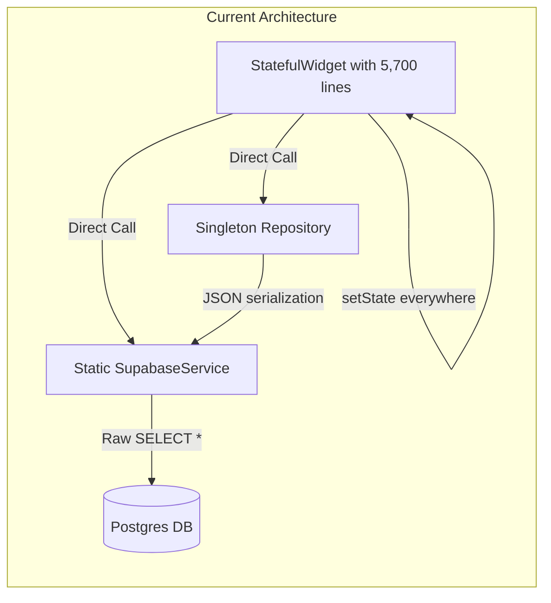
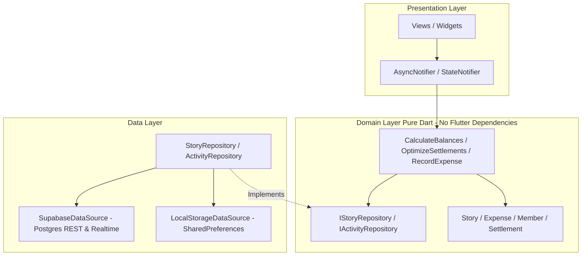

# 04 — Architecture & State Management Review

## 1. Evaluation of Current Architectural Layers



The current architecture represents an **ad-hoc Service-Locator / Stateful-Scripting Hybrid**:

1. **Presentation Layer:** Dominated by heavy `StatefulWidget` instances that manage both presentation rendering, local form state, and domain logic.
2. **Business Logic Layer:** Virtually absent as an isolated layer. Business logic is split between domain model constructors (`Story._buildCalculatedStory`) and screen lifecycle methods (`SplitDetailScreen._recalculateBalances`).
3. **Data Access Layer:** Mediated through singleton repositories (`StoryRepository.instance`, `ActivityRepository.instance`, `FriendsRepository.instance`), which wrap `SupabaseService` and `StorageService`.

---

## 2. Architectural Weaknesses

### 1. The "Bypass the Repository" Anti-Pattern
While repositories exist, presentation screens frequently bypass them to communicate directly with low-level infrastructure services:
- [`split_detail_screen.dart#L1175`](file:///Users/roshanbadwaik/Developer/flutter-bill-splitter/lib/features/expenses/presentation/screens/split_detail_screen.dart#L1175) calls `StoryRepository.instance.updateStory()` directly.
- [`split_detail_screen.dart#L1193`](file:///Users/roshanbadwaik/Developer/flutter-bill-splitter/lib/features/expenses/presentation/screens/split_detail_screen.dart#L1193) calls `ActivityRepository.instance.recordActivity()` directly.
- [`split_detail_screen.dart#L249`](file:///Users/roshanbadwaik/Developer/flutter-bill-splitter/lib/features/expenses/presentation/screens/split_detail_screen.dart#L249) opens a direct Supabase Realtime channel subscription inside the widget state lifecycle.

When UI widgets establish raw WebSocket connections and invoke low-level persistence APIs, testing the widget in isolation without running full Supabase mocks becomes virtually impossible.

### 2. State Inconsistency & Fragility (Ad-hoc `setState`)
State updates are triggered imperatively via local `setState(() { _story = updated; })`. If a user modifies an expense in `SplitDetailScreen`, the parent `MainScreen` or sister `HomeTab` only receives the update if the repository happens to notify its listeners and the consuming widget is actively listening.
- Because `SplitDetailScreen` keeps its own private `_story` and `_memberExpenses` copies, it frequently falls out of sync with `StoryRepository.getStoryById()`.

---

## 3. Recommended Clean Architecture (Pragmatic & Lightweight)

To scale TTMM Club over the next 3–5 years without adding unnecessary enterprise boilerplate, we recommend adopting a **Feature-First Layered Architecture**:



### Layer Rules:
1. **Domain Layer (Pure Dart):**  
   - Zero imports of `package:flutter/material.dart` or `package:supabase_flutter/supabase_flutter.dart`.
   - Contains pure data classes, immutable value objects, and deterministic business calculations (`CalculateBalancesUseCase`, `OptimizeSettlementsUseCase`).
2. **Data Layer:**  
   - Implements repository interfaces.
   - Manages caching, offline queueing, and network synchronization.
3. **Presentation Layer:**  
   - Widgets are strictly declarative readers of state and emitters of user intents.
   - All state mutations are handled by controllers or notifiers.

---

## 4. State Management Recommendation: Riverpod

Given TTMM Club's requirements (offline caching, real-time cloud streams, deep-linking, multi-tab coordination), **Riverpod (v2 with code generation)** is the ideal state management framework:

### Why Riverpod over current Singleton `ChangeNotifier`?
1. **Compile-time Safety & Scoped Lifetime:** Prevents memory leaks by automatically disposing of real-time stream subscriptions when the user leaves a story screen (`autoDispose`).
2. **Elimination of Global Mutable State:** Replaces global singleton instances with dependency-injected providers, allowing trivial mocking in unit tests.
3. **Built-in AsyncValue:** Natively models Loading, Error, and Data states without repetitive `bool isLoading` flags across screens.

#### Example Target Controller:
```dart
@riverpod
class StoryDetailController extends _$StoryDetailController {
  @override
  FutureOr<Story> build(String storyId) async {
    // Automatically subscribes to Supabase Realtime and updates UI reactively
    final repository = ref.watch(storyRepositoryProvider);
    return repository.getStoryStream(storyId);
  }

  Future<void> addExpense(StoryExpense expense) async {
    state = const AsyncValue.loading();
    state = await AsyncValue.guard(() async {
      final repository = ref.read(storyRepositoryProvider);
      return await repository.addExpense(storyId, expense);
    });
  }
}
```
