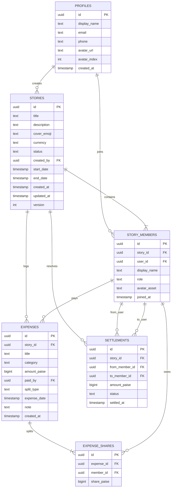

# 05 — Database & API Architecture Audit

## 1. Current Database Schema & Storage Model

The production Supabase PostgreSQL database currently employs a **Hybrid Document-Store Pattern**:

```
profiles
├── id (uuid, primary key)
├── display_name (text)
├── email (text)
├── phone (text)
├── avatar_url (text)
└── avatar_index (integer)

stories
├── story_id (text, primary key)
├── user_id (text, index)
├── title (text)
├── description (text)
├── cover_emoji (text)
├── currency (text)
├── status (text)
├── created_by (text)
├── created_at (timestamp)
└── data (jsonb)  <--- MONOLITHIC DOCUMENT CONTAINING ALL NESTED DATA

activities
├── id (text, primary key)
├── user_id (text)
├── group_name (text)
├── total_amount (numeric)
├── share_per_person (numeric)
├── timestamp (timestamp)
└── data (jsonb)  <--- NESTED EVENT DATA
```

---

## 2. Critical Database Deficiencies

### Deficiency 1: The Monolithic JSON Document Anti-Pattern
All core domain entities—**Members, Expenses, Split Shares, Member Balances, and Settlement Records**—are serialized into a single `data` JSONB column inside `stories`.
- **Concurrency Risk (Lost Updates):**  
  PostgreSQL cannot merge two concurrent updates to nested JSON keys in the same row. If Member A adds an expense for ₹500 and Member B simultaneously records a settlement for ₹200, both clients fetch the document, mutate it locally, and send back a full `.upsert({ data: updatedJson })`. The transaction that finishes last completely overwrites the first. The first expense disappears forever.
- **Index Inefficiency:** Queries cannot index which members belong to which stories without complex JSONB path indexes (`data->'members'`).
- **Network Payload Bloat:** Adding a single ₹50 expense requires transmitting the entire historical JSON document (all past expenses, receipt metadata, and settlement histories) back to the server.

---

### Deficiency 2: Unbounded Table Scanning (Missing Server-Side Filtering)
In `lib/core/services/supabase_service.dart:508`:
```dart
final response = await cli
    .from('stories')
    .select()
    .order('created_at', ascending: false);
```
**Evaluation:**
- This query performs a **`SELECT * FROM stories`** without any `WHERE` clause or user ID constraint.
- The server responds with **every single story across all users in the system**.
- Filtering is performed on the client in Dart:
  ```dart
  final isAllowed = isCreator || isMember;
  if (isAllowed) { ... }
  ```
- **Consequences:**
  1. **Security Vulnerability:** Any user can intercept network traffic or query the Supabase endpoint to view all stories, members, and financial splits in the system.
  2. **Bandwidth Exhaustion:** At 100,000 stories, launching the app requires downloading 50–100 MB of JSON data.
  3. **High Database CPU:** Sequential table scans on unindexed JSON columns degrade database response times.

---

## 3. Recommended Normalized Relational Schema

To ensure ACID compliance, eliminate concurrency lost-updates, and enable efficient indexing, TTMM Club must transition to a fully normalized schema:



---

## 4. Production SQL Migration Script (DDL & RLS)

```sql
-- 1. Create Stories Table
CREATE TABLE public.stories (
    id UUID PRIMARY KEY DEFAULT gen_random_uuid(),
    title VARCHAR(120) NOT NULL,
    description TEXT,
    cover_emoji VARCHAR(8) DEFAULT '🌴',
    currency VARCHAR(3) DEFAULT 'INR',
    status VARCHAR(20) DEFAULT 'active' CHECK (status IN ('active', 'settled', 'archived')),
    created_by UUID REFERENCES auth.users(id) ON DELETE SET NULL,
    start_date DATE,
    end_date DATE,
    version INT DEFAULT 1,
    created_at TIMESTAMPTZ DEFAULT NOW(),
    updated_at TIMESTAMPTZ DEFAULT NOW()
);

-- 2. Create Story Members Table
CREATE TABLE public.story_members (
    id UUID PRIMARY KEY DEFAULT gen_random_uuid(),
    story_id UUID NOT NULL REFERENCES public.stories(id) ON DELETE CASCADE,
    user_id UUID REFERENCES auth.users(id) ON DELETE SET NULL,
    name VARCHAR(100) NOT NULL,
    role VARCHAR(20) DEFAULT 'member' CHECK (role IN ('creator', 'admin', 'member')),
    avatar_url TEXT,
    joined_at TIMESTAMPTZ DEFAULT NOW(),
    UNIQUE(story_id, user_id)
);

-- 3. Create Expenses Table
CREATE TABLE public.expenses (
    id UUID PRIMARY KEY DEFAULT gen_random_uuid(),
    story_id UUID NOT NULL REFERENCES public.stories(id) ON DELETE CASCADE,
    title VARCHAR(150) NOT NULL,
    category VARCHAR(50) DEFAULT 'general',
    amount_paise BIGINT NOT NULL CHECK (amount_paise > 0),
    paid_by UUID NOT NULL REFERENCES public.story_members(id) ON DELETE RESTRICT,
    split_type VARCHAR(20) DEFAULT 'equal' CHECK (split_type IN ('equal', 'exact', 'percentage')),
    expense_date TIMESTAMPTZ NOT NULL DEFAULT NOW(),
    note TEXT,
    created_at TIMESTAMPTZ DEFAULT NOW()
);

-- 4. Create Expense Shares Table
CREATE TABLE public.expense_shares (
    id UUID PRIMARY KEY DEFAULT gen_random_uuid(),
    expense_id UUID NOT NULL REFERENCES public.expenses(id) ON DELETE CASCADE,
    member_id UUID NOT NULL REFERENCES public.story_members(id) ON DELETE CASCADE,
    share_paise BIGINT NOT NULL CHECK (share_paise >= 0),
    UNIQUE(expense_id, member_id)
);

-- 5. Create Settlements Table
CREATE TABLE public.settlements (
    id UUID PRIMARY KEY DEFAULT gen_random_uuid(),
    story_id UUID NOT NULL REFERENCES public.stories(id) ON DELETE CASCADE,
    from_member_id UUID NOT NULL REFERENCES public.story_members(id) ON DELETE RESTRICT,
    to_member_id UUID NOT NULL REFERENCES public.story_members(id) ON DELETE RESTRICT,
    amount_paise BIGINT NOT NULL CHECK (amount_paise > 0),
    status VARCHAR(20) DEFAULT 'pending' CHECK (status IN ('pending', 'completed', 'cancelled')),
    created_at TIMESTAMPTZ DEFAULT NOW(),
    completed_at TIMESTAMPTZ
);

-- 6. Indexes for High-Velocity Queries
CREATE INDEX idx_story_members_user ON public.story_members(user_id);
CREATE INDEX idx_story_members_story ON public.story_members(story_id);
CREATE INDEX idx_expenses_story ON public.expenses(story_id);
CREATE INDEX idx_expense_shares_expense ON public.expense_shares(expense_id);
CREATE INDEX idx_settlements_story ON public.settlements(story_id);

-- 7. Row Level Security Policies (Enforce Tenant Isolation)
ALTER TABLE public.stories ENABLE ROW LEVEL SECURITY;
ALTER TABLE public.story_members ENABLE ROW LEVEL SECURITY;
ALTER TABLE public.expenses ENABLE ROW LEVEL SECURITY;
ALTER TABLE public.expense_shares ENABLE ROW LEVEL SECURITY;
ALTER TABLE public.settlements ENABLE ROW LEVEL SECURITY;

-- Stories Policy: Users can only see stories they belong to
CREATE POLICY "Stories are viewable by group members" ON public.stories
    FOR SELECT USING (
        auth.uid() = created_by OR
        EXISTS (
            SELECT 1 FROM public.story_members
            WHERE story_members.story_id = stories.id
            AND story_members.user_id = auth.uid()
        )
    );

-- Expenses Policy: Only group members can view or add expenses
CREATE POLICY "Expenses viewable by story members" ON public.expenses
    FOR SELECT USING (
        EXISTS (
            SELECT 1 FROM public.story_members
            WHERE story_members.story_id = expenses.story_id
            AND story_members.user_id = auth.uid()
        )
    );
```
