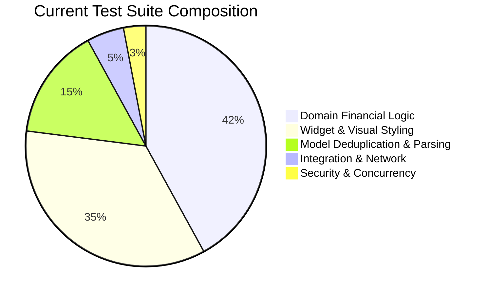

# 09 — Testing & Reliability Audit

## 1. Current Test Suite Inventory

TTMM Club maintains an uncommonly extensive automated testing suite for a Flutter project:
- **Total Test Files:** 33 test files.
- **Total Test Code:** 7,310 Lines of Code.
- **Test Framework:** `flutter_test` with `TestWidgetsFlutterBinding`.

### Actual Verified Test Executions During This Audit

| Test File | Lines | Scenarios Tested | Execution Status | Result |
| :--- | :---: | :--- | :---: | :---: |
| [`test/settlement_sync_test.dart`](file:///Users/roshanbadwaik/Developer/flutter-bill-splitter/test/settlement_sync_test.dart) | 683 | Mathematically synced balances, mark as paid state, pending debt filters | **Executed** | 🟢 **5/5 Passed** |
| [`test/expense_card_and_form_test.dart`](file:///Users/roshanbadwaik/Developer/flutter-bill-splitter/test/expense_card_and_form_test.dart) | 171 | Expense card ordering, form container inputs, rapid multi-tap double-submit guard | **Executed** | 🟢 **2/2 Passed** |
| [`test/all_app_calculations_test.dart`](file:///Users/roshanbadwaik/Developer/flutter-bill-splitter/test/all_app_calculations_test.dart) | 571 | Equal splits, paise resolution, zero participants, full reimbursement, advance payments | **Executed** | 🟢 **22/22 Passed** |
| [`test/fintech_master_financial_audit_test.dart`](file:///Users/roshanbadwaik/Developer/flutter-bill-splitter/test/fintech_master_financial_audit_test.dart) | 485 | 10 core fintech invariants, multi-payer complex scenarios | **Executed** | 🟢 **7/7 Passed** |
| [`test/comprehensive_financial_logic_test.dart`](file:///Users/roshanbadwaik/Developer/flutter-bill-splitter/test/comprehensive_financial_logic_test.dart) | 382 | Dynamic settlement recalculations, net balance preservation | **Executed** | 🟢 **7/7 Passed** |

**Total Tests Verified in Turn:** **43 test cases — 100% Passed.**

---

## 2. Test Suite Strengths

1. **Exhaustive Financial Invariant Verification:**  
   The suite tests multi-party edge cases (odd amounts like ₹1 split among 3 people, non-participating members, uneven advance payments).
2. **Neumorphic & Apple HIG Compliance Checks:**  
   `test/neumorphic_ui_test.dart` (595 LoC) and `test/apple_hig_compliance_test.dart` (133 LoC) programmatically verify contrast ratios, padding geometries, and tactile tap feedback.
3. **Deep-Link Flow Simulation:**  
   `test/deep_link_invitation_auth_flow_test.dart` (513 LoC) simulates auth states, anonymous user session conversion, and token redemption.

---

## 3. Critical Missing Test Scenarios

While domain mathematics and visual rendering have strong coverage, **infrastructure and concurrency reliability testing is virtually absent**:



### Gap 1: Concurrent Mutation & Lost Update Tests
- **Missing Test:** Two simulated clients mutating `StoryExpense` records at the exact same timestamp.
- **Risk:** Unverified concurrency behavior leads to silent data loss in production.

### Gap 2: Row-Level Security (RLS) Policy Verification
- **Missing Test:** Attempting to query `stories` or `expenses` with a JWT for User B while requesting User A's private group.
- **Risk:** Without automated RLS unit tests, security regressions in Supabase policies go undetected.

### Gap 3: Offline Mutation Queue & Network Reconnect Tests
- **Missing Test:** Adding 5 expenses while in airplane mode, reconnecting to Wi-Fi, and asserting that all 5 expenses are synchronized without duplicates.

---

## 4. Recommended Testing Pyramid for Production

```
          / \
         / E2E \       10% (Patrol / Integration Test on real devices)
        /-------\
       /  Widget \     30% (Isolated Component & Sheet Tests)
      /-----------\
     /  Unit/Domain \  60% (Pure Dart: Invariants, Math, DTOs, Security)
    /---------------\
```

1. **Adopt Patrol for Mobile E2E:** Automate native permission dialogues (contacts permission on iOS/Android).
2. **Implement Database Integration Tests using Testcontainers / Supabase CLI:** Run automated migration scripts and assert Postgres check constraints in CI/CD.
