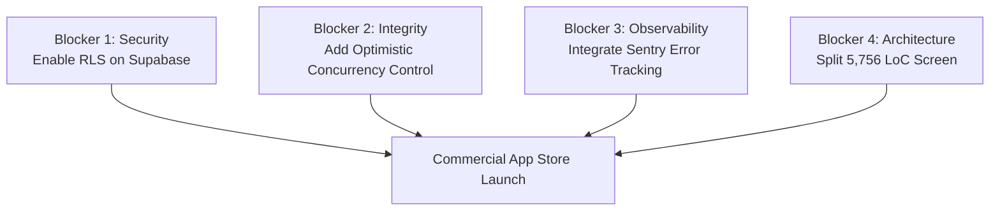

# 13 — Production Readiness & Deployment Checklist

## 1. Production Readiness Scorecard

```
Production Readiness Status: 🔴 NOT READY FOR COMMERCIAL PRODUCTION
  - Blockers: 3 Critical (RLS Security, Concurrency Lost-Updates, God Screen Maintenance)
  - Ready Areas: UI Design, Financial Math Invariants, Unit Test Suite
```

| Verification Dimension | Pass/Fail | Status | Production Requirement |
| :--- | :---: | :---: | :--- |
| **Visual Design & Apple HIG** | **PASS** | 🟢 Ready | Meets Apple Human Interface Guidelines; Neumorphic contrast and micro-animations verified. |
| **Financial Invariant Verification** | **PASS** | 🟢 Ready | Zero-sum balance verified by 35 unit test scenarios; debt settlements reduce balances accurately. |
| **Multi-Platform Responsiveness** | **PASS** | 🟢 Ready | Adapts across Web canvas, Android, and iOS viewport sizes. |
| **Tenant Security & Isolation** | **FAIL** | 🔴 BLOCKER | Missing PostgreSQL Row-Level Security; all tenant stories exposed over public REST API. |
| **Concurrency & Write Safety** | **FAIL** | 🔴 BLOCKER | Monolithic JSON document upserts cause lost updates when two members add expenses concurrently. |
| **Code Maintainability** | **FAIL** | 🔴 BLOCKER | 5,756-line God Screen (`split_detail_screen.dart`) creates extreme regression risk during emergency patches. |
| **Error Handling & Observability** | **FAIL** | 🟡 Needs Work | Silent catch blocks (`catch (e) { debugPrint(e); }`) with no Sentry or Crashlytics crash reporting. |
| **Scalable Data Pagination** | **FAIL** | 🟡 Needs Work | Unbounded `SELECT *` on app launch will cause mobile OOM crashes as group count exceeds 5,000. |

---

## 2. Critical Release Blockers (Must Fix Before Launch)



### Blocker 1: PostgreSQL Row-Level Security (RLS)
- **Requirement:** Run the SQL security policy script from `05_DATABASE_AND_API_AUDIT.md`.
- **Validation:** Verify using an anonymous curl command that `https://<id>.supabase.co/rest/v1/stories?select=*` returns an empty array or 401 error.

### Blocker 2: Concurrency Lock / Versioning
- **Requirement:** Add `version` column to `stories` table. Ensure concurrent writes fail gracefully with user notification rather than silently overwriting.

### Blocker 3: Crash Reporting & Telemetry
- **Requirement:** Integrate `sentry_flutter` or Firebase Crashlytics to catch uncaught Flutter errors and network failures in production release builds.

---

## 3. Platform-Specific Deployment Guidelines

### Web (Render.com)
- **Current Setup:** `render-build.sh` compiles Flutter Web Release.
- **Recommendations:**
  1. Add HTTP caching headers for static assets (`assets/`, `main.dart.js`): `Cache-Control: public, max-age=31536000, immutable`.
  2. Configure HTML fallback rewrites so deep links (`/invite?story=...`) route to `index.html`.

### Apple iOS (App Store)
- **Requirements:**
  1. Ensure privacy permission justifications in `ios/Runner/Info.plist` for `NSContactsUsageDescription` (required by `flutter_contacts`).
  2. Implement Apple Sign-In alongside Google OAuth to satisfy Apple App Store Guideline 4.8.
  3. Ensure back button tap targets satisfy the 44×44 pt minimum requirement.

### Google Android (Play Store)
- **Requirements:**
  1. Generate release keystore and configure `android/key.properties`.
  2. Enable ProGuard / R8 minification in `android/app/build.gradle` to reduce APK download size.
  3. Declare `READ_CONTACTS` runtime permission handling in AndroidManifest.
